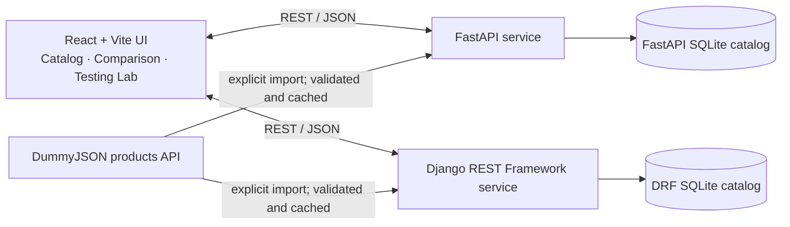

# Django REST Framework vs FastAPI — API Forge

An IMAD / third-year BTech ICA prototype comparing equivalent product APIs through one React + Vite interface. The supplied `api_forge.html` is the frontend design reference: its API Architects header, centered “Backend Showdown” hero and framework toggle, live endpoint catalog, side-by-side code examples, benchmark and validation cards, research notes, and documentation panel are now implemented as the working React page. React owns the interactions so the product catalog, CRUD, backend switch, import, measurements, and test results use the real project APIs and reports. Hard-coded sample benchmark claims and misleading async labels from the static reference were replaced with measured report values and an accurate description of the synchronous implementation.

## Project brief and people

**Objective:** implement the same product catalog workflow in Django REST Framework (DRF) and FastAPI, then compare validation, persistence, documentation, code size and measured local HTTP behavior.

**Project members:** not supplied. Fill in names before submission; roles below are placeholders and must be assigned by the team.

| Member | Actual role to fill in |
|---|---|
| `[Member name]` | `[e.g. backend APIs and validation]` |
| `[Member name]` | `[e.g. React interface and integration]` |
| `[Member name]` | `[e.g. testing, research and report]` |

Do not submit the placeholders as real member information. Git history was not available in the delivered project folder, so this project makes no claims about commits or contribution history.

## Architecture and data flow



The two SQLite files are separate by design: each framework owns its local records, IDs and CRUD changes. Switching the backend switches the catalog being read. DummyJSON is an external sample source; import copies supported fields into the selected local database. CRUD, tests and benchmarks do not require DummyJSON availability. Successful upstream responses are cached in memory for five minutes to reduce repeat requests. An upstream timeout, HTTP error or malformed response returns 502 without partially importing rows.

## Requirements and local setup

Use Python 3.11+ and Node 20.19+ (or a newer compatible Node release). Install the three services independently. Open three terminals from this project directory.

### FastAPI

```powershell
cd backend/fastapi_app
python -m venv .venv
.venv\Scripts\Activate.ps1
pip install -r requirements.txt
uvicorn main:app --reload --port 8000
```

macOS/Linux activation: `source .venv/bin/activate`. Docs: `http://localhost:8000/docs` and `/redoc`.

### Django REST Framework

```powershell
cd backend/drf_app
python -m venv .venv
.venv\Scripts\Activate.ps1
pip install -r requirements.txt
python manage.py migrate
python manage.py runserver 8001
```

macOS/Linux activation: `source .venv/bin/activate`. Swagger UI: `http://localhost:8001/api/schema/swagger-ui/`; OpenAPI schema: `/api/schema/`.

### React + Vite

```powershell
cd frontend
npm install
npm run dev
```

Open the URL printed by Vite (normally `http://localhost:5173`). Optional browser origins are in `frontend/.env.example`; copy it to `frontend/.env` and adjust `VITE_FASTAPI_URL` or `VITE_DRF_URL`. These values are public browser configuration, never secrets. The defaults target local development.

For Django environment settings, copy root `.env.example` to `.env` and set `DJANGO_SECRET_KEY`, `DJANGO_DEBUG=False` and `DJANGO_ALLOWED_HOSTS` appropriately outside local development. Never commit real secrets. `FASTAPI_DB_PATH` and `DRF_DB_PATH` can point to alternate SQLite files. By default each backend writes its own database beside its source; those files are ignored by Git.

## API contract

All endpoints use `/api/v1` and JSON. Successful object responses use `{ "data": ... }`; product lists also return `{ "meta": {"total", "limit", "offset"} }`.

| Method | Path | Purpose |
|---|---|---|
| GET | `/health` | Database-backed health check |
| GET | `/products?q=&limit=20&offset=0` | Search and paginate a backend's local catalog |
| POST | `/products` | Create product (201) |
| GET | `/products/{id}` | Retrieve one product |
| PUT | `/products/{id}` | Replace product fields |
| PATCH | `/products/{id}` | Update supplied fields only |
| DELETE | `/products/{id}` | Delete product |
| POST | `/products/import-dummyjson` | Fetch, validate and import source products |
| POST | `/validation/example` | Serializer/Pydantic example without persistence |

Example:

```bash
curl -X POST http://localhost:8000/api/v1/products \
  -H "Content-Type: application/json" \
  -d '{"title":"Desk lamp","description":"Warm LED","price":24.99,"category":"Home","stock":8,"image":"https://example.com/lamp.png"}'
curl http://localhost:8001/api/v1/products?limit=20
```

Product rules are matched: title is a trimmed string with 2–120 characters; description is an optional string up to 500 characters; price is a finite number at least 0.01; category is a trimmed nonempty string up to 80 characters; stock is an integer at least zero; image is empty or a valid HTTP(S) URL up to 500 characters. Unknown input fields and explicit nulls are rejected. Missing required create/replace fields fail. PATCH accepts only supplied product fields; empty PATCH is consistently 422. Missing product IDs return 404. Both APIs use 422 validation status and a `detail` list with field locations, but exact wording and root-error locations can reflect DRF versus Pydantic conventions.

DummyJSON import returns `fetched`, `created`, `skipped`, `existing`, `cache_hit`, and `source`. `created` counts records actually inserted; `skipped`/`existing` count fetched records already represented by title/category. A repeated successful import therefore reports zero new creations. No external ID is used as a local database ID. Official source API reference: [DummyJSON Products](https://dummyjson.com/docs/products).

## Tests and verification

Run the complete test and build sequence from the project root:

```bash
python -m pip install -r requirements-dev.txt
python scripts/run_checks.py
```

The script runs FastAPI pytest tests plus cross-framework contract tests, Django's test suite, and the frontend production build. A factual summary is saved to `quality-results/latest.json`; reproducible source-size counts are saved to `quality-results/loc.json`. The contract test provisions isolated test SQLite data and compares equivalent create, PATCH, list, retrieve, error-status, field-set and health behavior. Import tests mock DummyJSON; they do not load-test the public service.

The comparison UI has a manual **Run validation example** control and the API Testing Lab checks valid payload, missing title, price below minimum, negative stock, invalid image URL, unexpected field, empty PATCH, wrong types, valid PATCH and missing product against both services. It displays actual status, measured client latency and JSON. Network-offline outcomes are explicit. Successful lab creates are deleted; PATCH checks preserve the original stock value.

## Benchmark methodology and current measurement

Run the reproducible benchmark from the project root:

```bash
python scripts/benchmark.py
```

The default run starts one Uvicorn worker for each application on free loopback ports, prepares separate temporary SQLite files (each seeded with the same three sample products), warms up each route, then runs repeated concurrent requests for health, list (`limit=20`) and retrieval of a seeded product. It records UTC time, Python/platform and dependency versions, server settings, database state, cache/upstream settings, warmups, samples, trial variability, mean, median, P95 and observed throughput. The same runner, seed catalog, request shapes and local network path are used. No DummyJSON request occurs during the benchmark. Latency includes local HTTP and Python client overhead; the small run is illustrative, not a capacity test. Throughput is completed requests divided by trial wall time.

The script writes a fresh report to `benchmark-results/latest.json` and copies it to the frontend's public report path. On this workspace's latest run, measured 2026-10-23 20:21 UTC, Python 3.13.7 / Windows 11, Uvicorn one worker, temporary SQLite with three products, 30 requests per route per trial, 5 warmups, 3 trials, concurrency 4. Each route uses 90 measured samples. Current mean / median / P95 latency and throughput were:

| Route | FastAPI | DRF |
|---|---:|---:|
| Health | 9.162 / 6.230 / 24.717 ms · 397.35 req/s | 20.639 / 20.715 / 26.025 ms · 182.11 req/s |
| Product list | 11.421 / 7.459 / 30.247 ms · 310.99 req/s | 34.117 / 32.895 / 50.319 ms · 114.07 req/s |
| Product retrieve | 9.037 / 7.348 / 21.853 ms · 371.75 req/s | 28.289 / 27.084 / 41.640 ms · 136.22 req/s |

The local run is not evidence that one framework is universally faster; it reflects one setup, tiny seeded data and short trials. The full per-trial variation is in JSON. Future runs replace `latest.json`; archive wanted reports separately.

Historical health-only values from the earlier supplied run are preserved separately in `benchmark-results/historical-health.json`: FastAPI mean 18.498 ms, median 17.606 ms, P95 30.953 ms, 256.94 req/s; DRF mean 23.073 ms, median 22.462 ms, P95 39.833 ms, 201.64 req/s. These are **historical** and are not the current benchmark. An earlier checked-in sample also remains in `benchmark-20261023-231336.json` and is historical.

## Code-size method

Run `python scripts/count_loc.py` (also run by `run_checks.py`). It counts nonblank physical source lines and omits standalone comment lines. Total application LOC includes FastAPI application code, DRF product implementation and the shared frontend. Framework-specific counts are broken out; FastAPI's single module includes app setup and routes, while DRF's count includes product model, serializer, view and exception code. Django settings/project boilerplate and scripts, generated migrations, and tests are reported separately. Dependencies, generated frontend bundles, databases, caches and README are excluded. In this checkout the latest total is **1,910 application LOC**: **240 FastAPI feature LOC**, **225 DRF feature LOC**, 257 configuration/script LOC, 42 migration LOC and 278 test LOC (latter three categories reported separately). The frontend accounts for 1,445 LOC across its entry HTML, React components and styles. Physical LOC depends on formatting and does not measure complexity, correctness or maintainability. The generated `quality-results/loc.json` has per-file values. Do not infer that DRF is twice as verbose from this small prototype.

## Research notes

### Serializers vs Pydantic

DRF serializers validate and convert request values to model-ready data; `ModelSerializer` can derive fields from Django models. FastAPI request models use Pydantic annotations and constraints, and its validation integrates with generated OpenAPI. Both backends enforce the same product rules and return matching status/envelope contracts; framework-specific details and messages may differ. The DRF serializer also rejects undeclared fields explicitly so inputs cannot silently diverge from FastAPI's `extra="forbid"`. References: [DRF serializers](https://www.django-rest-framework.org/api-guide/serializers/), [DRF fields](https://www.django-rest-framework.org/api-guide/fields/), [FastAPI request bodies](https://fastapi.tiangolo.com/tutorial/body/).

### Synchronous vs asynchronous execution

The current FastAPI handlers are regular `def` functions. They use synchronous SQLite calls, and the DummyJSON importer uses synchronous `httpx.get`; DRF's views/ORM are also synchronous. This is an intentionally simple like-for-like CRUD prototype, not an async-performance demonstration. Async can help when a service spends time waiting on async-compatible I/O and the whole call path is nonblocking; it does not make CPU-bound work faster. Do not infer async behavior from FastAPI's capabilities alone. Reference: [FastAPI async guidance](https://fastapi.tiangolo.com/async/).

### Documentation, trade-offs and selection

FastAPI creates OpenAPI from route annotations and Pydantic models and serves Swagger UI at `/docs` plus ReDoc at `/redoc`. DRF uses `drf-spectacular` for its OpenAPI schema and Swagger UI; schema declarations should be checked against actual behavior. DRF fits projects that benefit from Django's integrated ORM, admin, permissions and established conventions. FastAPI fits API-first services that value typed request models and straightforward OpenAPI generation, and can support async I/O when the chosen dependencies do. Team experience, integrations, operational needs and representative benchmarks matter more than a universal ranking. Benchmark results here cover one tiny local workload only.

### Conclusion from this prototype

In the latest measured local run, FastAPI had lower mean latency and higher observed throughput for all three tested routes; the DRF list route had a wider P95 (50.319 ms versus 30.247 ms). This result is specific to the installed versions, one Uvicorn worker, local loopback, a three-record SQLite catalog and short trials. The framework-specific LOC buckets were close (237 FastAPI versus 223 DRF), with different counting boundaries because FastAPI's app and routes share one file. Validation tests show matching status behavior for the covered scenarios; DRF and Pydantic still express error locations/messages differently. Both generate interactive API documentation, through FastAPI's OpenAPI support and DRF's `drf-spectacular`. Maintainability depends on the team's familiarity and project structure: DRF separates models, serializers and views, while this compact FastAPI prototype keeps routes and schemas in one module. This evidence does not establish a universal winner.

### Limitations

- SQLite and three seed products are appropriate for a classroom demo, not a production concurrency or scaling claim.
- In-memory upstream cache is process-local and expires after five minutes; it is not shared across workers or restarts.
- DummyJSON is public and external; imports require network access. No fixed upstream rate limit is assumed; the cache and modest page size reduce unnecessary repeat requests.
- Local benchmark values vary by hardware, background activity, dependency versions and server configuration.
- Git history and actual member names/roles were not provided; fill in team details before submission.

## 10-minute demo plan

1. **0:00–1:00** State the objective and diagram the React client, two APIs, separate SQLite files and DummyJSON source.
2. **1:00–3:00** Create, edit, search and delete a product with FastAPI; show health and `/docs`.
3. **3:00–4:00** Switch to DRF and show its independent catalog and Swagger schema.
4. **4:00–5:00** Import DummyJSON once, then repeat to show created versus skipped counts and cache status.
5. **5:00–7:00** Run the validation lab and compare matching statuses and field errors, including empty PATCH and missing ID.
6. **7:00–8:30** Show comparison data, timestamp, sample count and benchmark configuration; distinguish historical results.
7. **8:30–10:00** Explain serializers/Pydantic, sync/async, limitations and when each framework fits.

## Viva questions to prepare

1. **Why two databases?** Each backend owns an independent local catalog; switching APIs changes which local data the UI uses.
2. **What do GET, POST, PUT, PATCH and DELETE mean here?** Read, create, replace, partial update and delete; their status codes and effects are checked in both implementations.
3. **How do serializers differ from Pydantic?** DRF serializers map/validate Django model data; Pydantic validates typed request models used by FastAPI and OpenAPI.
4. **Why is PATCH a separate schema?** Only supplied fields are validated and applied; required create fields are not incorrectly required, while unknown/null/empty updates have explicit behavior.
5. **Why SQLite?** It is a low-setup persistent store suited to this assignment; it is not a production database recommendation.
6. **What is cached?** A validated DummyJSON response is cached in memory for five minutes to avoid repeated external calls.
7. **Is the FastAPI code async?** No. Its handlers and SQLite/upstream calls in this prototype are synchronous.
8. **What does the benchmark measure?** Local client-to-server HTTP latency/throughput for health, list and retrieve, with identical temporary seed data and repeated trials; it does not predict production performance.
9. **How should a framework be selected?** Based on project requirements, team familiarity, ecosystem, async needs and representative tests, not one small benchmark.

## Screenshots and submission

Capture genuine screenshots from the running app for: catalog with each backend selected, successful CRUD/import behavior, validation lab results and comparison report. Store them in your submission folder and refer to them here; screenshots are intentionally not fabricated or included as if they were captured. Complete member names/roles and verify setup on the presentation machine.

## Docker (optional local demonstration)

With Docker Compose installed, `docker compose up --build` starts the three local services at ports 5173, 8000 and 8001. Named volumes preserve the separate databases. This is a demonstration configuration, not deployment infrastructure. A real deployment needs production-grade ASGI/WSGI serving, secure environment secrets, TLS/proxying, persistent managed storage, backups and appropriate database settings; do not expose Django/Vite development servers as production services.

## Repository hygiene and layout

`.gitignore` excludes `.env`, SQLite files and sidecars, Python caches, virtual environments, `node_modules`, build output and test caches. Keep credentials out of source and browser configuration. Main files: `backend/fastapi_app/`, `backend/drf_app/`, `frontend/`, `tests/test_contract.py`, `scripts/benchmark.py`, `scripts/count_loc.py`, `scripts/run_checks.py`, `benchmark-results/`, and `quality-results/`.
